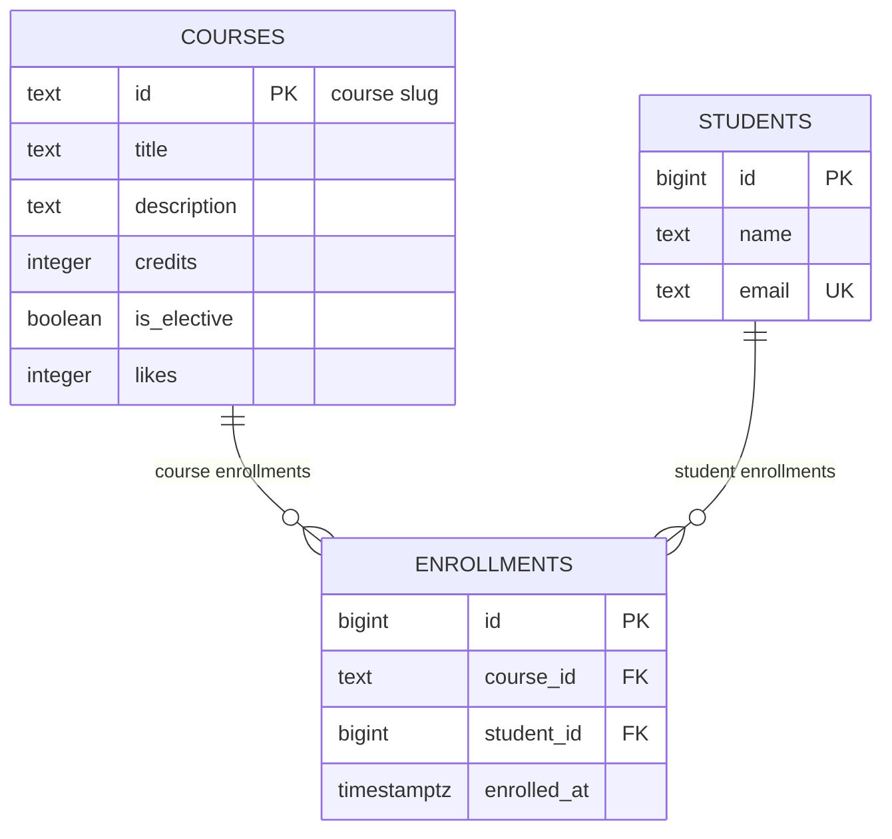

# course-catalog-db

PostgreSQL schema for the course catalog (Lab 6, "Advanced Web Technologies").

## How to run

PostgreSQL 16 or newer is required. Once, as the `postgres` superuser:

```sql
CREATE ROLE catalog_app LOGIN PASSWORD 'change-me';
CREATE DATABASE course_catalog OWNER catalog_app;
```

Then, from the project folder (it stops at the first error): 

```bash 
psql -h localhost -U catalog_app -d course_catalog -v ON_ERROR_STOP=1 -f schema.sql 
psql -h localhost -U catalog_app -d course_catalog -v ON_ERROR_STOP=1 -f seed.sql 
psql -h localhost -U catalog_app -d course_catalog -v ON_ERROR_STOP=1 -f queries.sql 
``` 

The password `change-me` is for teaching; real projects keep passwords out of git.

## Schema



The database consists of three tables: courses, students, and enrollments. The courses and students tables have a many-to-many relationship, which is implemented through the enrollments junction table. Each enrollment links exactly one course to one student.

## Design decisions
- Why courses.id is text (slug) while students.id is an automatic number: Course IDs like modern-frontend are readable natural keys that match frontend routes without extra lookups. Student IDs are surrogate bigint auto-increments because names can repeat and email addresses can change over time.
- Why RESTRICT on enrollments.course_id but CASCADE on enrollments.student_id: Deleting a course with active enrollments could lead to unintended data loss for students, so deletion is restricted until enrollments are removed. Deleting a student should cleanly purge all associated enrollment records automatically.
- Why timestamptz and not timestamp, and text instead of varchar(n): timestamptz preserves specific moments in time unambiguously across timezones. PostgreSQL treats text without length penalties, making varchar(n) necessary only if there is a strict domain limit.

## Constraint violation log

Commands were run with `\set VERBOSITY verbose`.

| # | What we violate | SQLSTATE | Constraint | API response |
|---|---|---|---|---|
| 1 | NULL in courses.title | 23502 | title (COLUMN NAME) | 422 Unprocessable Entity (if Pydantic let it through: 500) |
| 2 | courses.credits = 0 | 23514 | courses_credits_check | 422 Unprocessable Entity |
| 3 | courses.likes = -1 | 23514 | courses_likes_check | 500 Internal Server Error (only server code increments likes) |
| 4 | a one-letter student name | 23514 | students_name_check | 422 Unprocessable Entity |
| 5 | a duplicate student email | 23505 | students_email_key | 409 Conflict |
| 6 | a duplicate course id | 23505 | courses_pkey | 409 Conflict |
| 7 | a repeated enrollment in a course | 23505 | enrollments__student_id_course_id_key | 409 Conflict |
| 8 | enrolling in a nonexistent course | 23503 | enrollments_course_id_fkey | 404 Not Found (or 422 Unprocessable Entity) |
| 9 | enrolling a nonexistent student | 23503 | enrollments_student_id_fkey | 404 Not Found (or 422 Unprocessable Entity) |
| 10 | deleting a course that has enrollments | 23503 | enrollments_course_id_fkey | 409 Conflict (course with enrollments cannot be deleted) |
| 11 | deleting a student (ON DELETE CASCADE) | N/A (success) | N/A | Deleting a student deletes their enrollments by cascade (6 -> 3 enrollments left, 6 after ROLLBACK) |
| 12 | inserting a manual ID into students.id | 428C9 | GENERATED ALWAYS AS IDENTITY | 500 Internal Server Error (attempt to insert non-DEFAULT value into identity column) |

### Why repeat Pydantic checks in the database?
Pydantic performs input validation in the application memory, but it only protects the data entering through the API endpoints. Database constraints act as the final line of defense against invalid data introduced by SQL scripts, direct `psql` administration, migration bugs, or race conditions from parallel requests. Constraints ensure long-term data integrity regardless of application code updates.

## Index: EXPLAIN before and after

Query: `SELECT * FROM enrollments WHERE student_id = 777;`  
Database `idx_demo`: 500 courses, 20,000 students, 50,000 enrollments.

| Metric | Before the index | After the index |
|---|---|---|
| Access method | Seq Scan | Bitmap Heap Scan (via Bitmap Index Scan) |
| Cost estimate | 0.00..1042.00 | 4.31..15.59 |
| Rows Removed by Filter | ~49997 | 0 |
| Execution Time | ~3.636 ms | ~0.052 ms |

### Query Plans

**Before index:**
Seq Scan on enrollments  (cost=0.00..1042.00 rows=3 width=34)
  Filter: (student_id = 777)

**After index:**
Bitmap Heap Scan on enrollments  (cost=4.31..15.59 rows=3 width=34)
  Recheck Cond: (student_id = 777)
  ->  Bitmap Index Scan on enrollments_student_id_idx  (cost=0.00..4.31 rows=3 width=0)
        Index Cond: (student_id = 777)

### Answers to questions

1. PostgreSQL automatically creates B-tree indexes only for PRIMARY KEY and UNIQUE constraints (e.g., students_email_key and composite UNIQUE (course_id, student_id)). It does not automatically build indexes on FOREIGN KEY columns. Since student_id is the second column in the composite index (course_id, student_id), it cannot be used efficiently for filtering by student_id alone.

2. For extremely small tables like courses (6 rows), all data fits into a single disk page. Reading the single page sequentially (Seq Scan) is cheaper and faster for the query planner than opening an index, fetching the record address, and then looking up the row. For 50,000 rows, scanning the whole table is expensive, so an index saves significant I/O operations.

3.  - Queries filtering or joining enrollments by student, such as SELECT * FROM enrollments WHERE student_id = X or JOIN enrollments ON student_id. 
    - Cascading deletions or checks when a student is removed (DELETE FROM students WHERE id = X), allowing the database to instantly locate child rows in enrollments to delete without scanning 50,000 records.

## Transaction

Scenario: enroll a new student in a course — two inserts in one transaction.

- The second insert failed due to a foreign key violation (`enrollments_course_id_fkey`). `psql` changed the prompt to `course_catalog=!>`, indicating that the current transaction was aborted and subsequent commands were ignored until the end of the block. After `ROLLBACK`, the first insert was reverted as well, leaving zero orphaned student records in the database (`count = 0`).
- Window B saw `count = 0` before `COMMIT` due to the default `Read Committed` isolation level. After `COMMIT` in Window A, Window B saw `count = 1`.
- Without a transaction, if the second insert had failed, the new student record would have remained permanently saved in the database without any course enrollments ("half an operation" / dangling row).

## Self-review against the checklist 

| What to check | Result | 
|---------------|--------| 
| Keys | Yes: PKs on all 3 tables, FKs on course_id and student_id in enrollments. | 
| Types | Yes: text for strings/slugs, integer for credits/likes, bigint for IDs, timestamptz for dates. | 
| Required values | Yes: critical columns are set to NOT NULL. | 
| Constraints | Yes: CHECK (credits > 0), CHECK (likes >= 0), CHECK (length(name) >= 2), UNIQUE (email), UNIQUE (course_id, student_id). | 
| Deletion | Yes: RESTRICT on course deletion, CASCADE on student deletion. | 
| Normalization | Yes: 3NF compliance (courses, students, enrollments). likes denormalized intentionally for atomic counter performance. | 
| Indexes and names | Yes: explicit index on student_id FK. Consistent snake_case naming across tables. | 